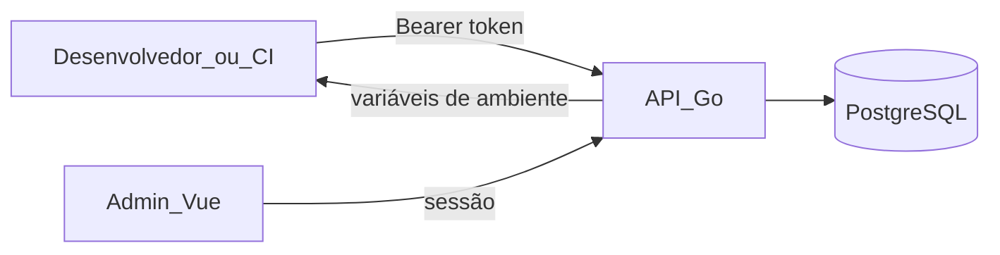

# envm-vault

Vault open source para gerenciamento e distribuição de variáveis de ambiente.

Com um token de acesso pessoal, desenvolvedores e pipelines de CI baixam variáveis de ambiente de projetos em ambientes customizáveis (`dev`, `tst`, `staging`, `prod`, ou qualquer nome que você definir).

## Status

**Fase 0** — documentação e base para agentes de IA. Código da aplicação em breve.

## Stack planejada

| Camada | Tecnologia |
|--------|------------|
| API | Go (monolito) |
| UI Admin | Vue 3 + TypeScript + Vite |
| Banco | PostgreSQL |

## Como funciona (visão geral)



1. Admin cria um **projeto** com **ambientes** customizáveis.
2. Admin cadastra **secrets** (pares chave-valor) por ambiente.
3. Admin gera um **token de acesso** com escopo por projeto/ambiente.
4. Desenvolvedor ou CI usa o token para baixar as variáveis:

```
GET /v1/projects/{project}/environments/{env}
Authorization: Bearer <seu_token>
```

## Documentação

| Documento | Descrição |
|-----------|-----------|
| [Arquitetura](docs/architecture.md) | Modelo de domínio, fluxos e princípios de segurança |
| [Roadmap](docs/roadmap.md) | Fases do projeto |
| [Guia de agentes](docs/agent-guide.md) | Como usar agentes de IA neste repositório |
| [AGENTS.md](AGENTS.md) | Instruções para coding agents |
| [Contribuindo](CONTRIBUTING.md) | Como contribuir |
| [Segurança](SECURITY.md) | Reporte de vulnerabilidades |

## Trabalhando com agentes de IA

Este repositório é otimizado para contribuições assistidas por agentes:

- **`AGENTS.md`** — instruções portáveis (Cursor, Copilot, Codex, etc.)
- **`.cursor/rules/`** — regras scoped por stack (Go, Vue)
- **`.cursor/skills/`** — workflows reutilizáveis (domínio, endpoints, security review)

Veja o [guia de agentes](docs/agent-guide.md) para prompts sugeridos.

## Contribuindo

Contribuições são bem-vindas! Leia [CONTRIBUTING.md](CONTRIBUTING.md) para começar.

## Licença

[MIT](LICENSE)

## English Summary

**envm-vault** is an open-source environment variable vault. Users download env vars for projects across customizable environments using a personal access token. Built with Go (API) and Vue 3 (admin UI). Currently in documentation phase — application code coming in Phase 1.

See [docs/architecture.md](docs/architecture.md) for technical details.
