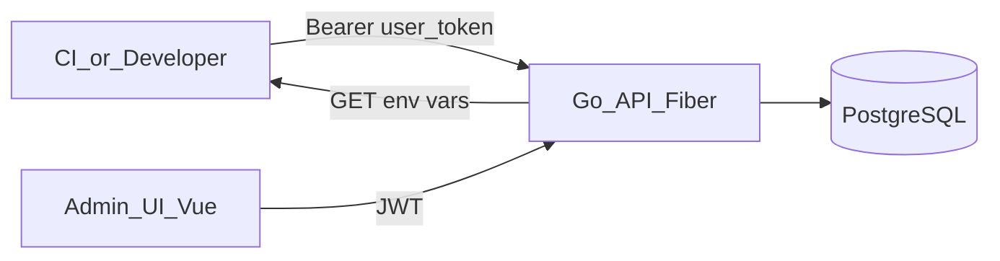
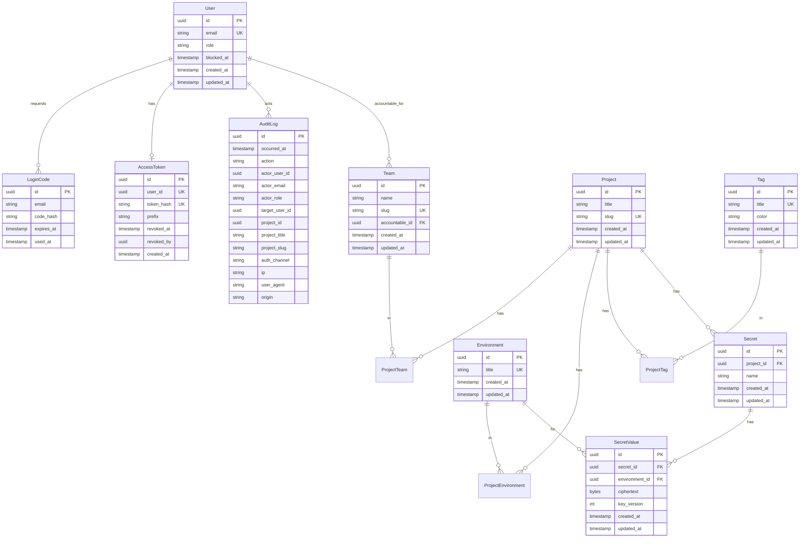

# Architecture

This document describes the architecture of **envm-vault**.

## Overview

envm-vault is an open-source environment variable vault. Users download environment variables for projects across customizable environments using a personal access token.



## Current Implementation (Phase 1)

The API lives in `api/` and provides authentication via email OTP plus a unique API key per user.

### Stack

| Component | Choice |
|-----------|--------|
| Language | Go 1.25+ |
| HTTP | Fiber v2 |
| Database | PostgreSQL 16 |
| DB driver | GORM (postgres driver) |
| Schema | GORM AutoMigrate |
| Data access | repository layer |
| Auth | Email OTP (8 digits, 10 min, max 5 verify attempts) + JWT |
| Admin UI | Vue 3 + Vite + TypeScript |
| UI styling | Tailwind CSS v4 + daisyUI 5 |

### API Endpoints

| Method | Route | Auth | Description |
|--------|-------|------|-------------|
| `GET` | `/v1/health` | — | Health check (API + DB) |
| `GET` | `/health` | — | Health check alias (infra probes) |
| `POST` | `/v1/auth/login` | — | Request OTP via email |
| `POST` | `/v1/auth/verify` | — | Verify OTP, returns JWT |
| `POST` | `/v1/auth/register` | JWT (admin+) | Register user (email + role) |
| `GET` | `/v1/tokens/me` | JWT | Current user's API key status (no secret) |
| `POST` | `/v1/tokens` | JWT | Generate or rotate the user's API key (plaintext once) |
| `DELETE` | `/v1/tokens` | JWT | Revoke the current user's API key |
| `GET` | `/v1/users` | JWT (admin+) | List users with API key status |
| `DELETE` | `/v1/users/:id/token` | JWT (admin+) | Revoke another user's API key |
| `POST` | `/v1/users/:id/block` | JWT (admin+) | Block user (revokes API key; denies login) |
| `POST` | `/v1/users/:id/unblock` | JWT (admin+) | Unblock user (does not restore API key) |
| `GET` | `/v1/audit-logs` | JWT (admin+) | Paginated audit logs (filters + sort) |
| `GET` | `/v1/teams` | JWT | List teams (optional `?name=` substring filter) |
| `POST` | `/v1/teams` | JWT (admin+) | Create team (name + accountable user) |
| `PATCH` | `/v1/teams/:id` | JWT (admin+) | Update team name and/or accountable |
| `DELETE` | `/v1/teams/:id` | JWT (admin+) | Delete team |
| `GET` | `/v1/tags` | JWT | List tags (optional `?title=` substring filter) |
| `POST` | `/v1/tags` | JWT | Create tag (title + hex color) |
| `PATCH` | `/v1/tags/:id` | JWT | Update tag title and/or color |
| `DELETE` | `/v1/tags/:id` | JWT | Delete tag |
| `GET` | `/v1/environments` | JWT | List environments (optional `?title=` substring filter) |
| `POST` | `/v1/environments` | JWT (admin+) | Create environment (title) |
| `PATCH` | `/v1/environments/:id` | JWT (admin+) | Update environment title |
| `DELETE` | `/v1/environments/:id` | JWT (admin+) | Delete environment |
| `GET` | `/v1/projects` | JWT | List projects (filters + page size 12) |
| `GET` | `/v1/projects/by-slug/:slug` | JWT | Get project by unique slug |
| `POST` | `/v1/projects` | JWT | Create project (title + teams + environments + tags) |
| `PATCH` | `/v1/projects/:id` | JWT | Update project |
| `DELETE` | `/v1/projects/:id` | JWT (admin+) | Delete project |
| `GET` | `/v1/projects/:id/secrets` | JWT | List secrets (names + which envs have values; no plaintext) |
| `POST` | `/v1/projects/:id/secrets` | JWT | Create secret (optional initial values per env) |
| `PATCH` | `/v1/projects/:id/secrets/:secretId` | JWT | Rename secret |
| `DELETE` | `/v1/projects/:id/secrets/:secretId` | JWT | Delete secret and all values |
| `PUT` | `/v1/projects/:id/secrets/:secretId/values/:environmentId` | JWT | Upsert encrypted value |
| `GET` | `/v1/projects/:id/secrets/:secretId/values/:environmentId` | JWT | Reveal one decrypted value |
| `DELETE` | `/v1/projects/:id/secrets/:secretId/values/:environmentId` | JWT | Clear value for one env |
| `GET` | `/v1/projects/:id/environments/:environmentId/values` | JWT | Export all values for an env (JSON or `?format=env`); `production` requires `super_admin` |
| `GET` | `/v1/projects/:slug/env` | API key (`ev_…`) | Download env vars via `?environment=<title>` (JSON default; dotenv via `?format=env` or `Accept: text/plain`). Only `super_admin` may download `production`. |

### Auth Flow

1. **Bootstrap:** When no users exist, the first successful OTP verification creates a `super_admin`.
2. **Login:** Registered users request OTP via `/v1/auth/login`, verify via `/v1/auth/verify`.
3. **Register:** `super_admin` or `admin` creates users via `/v1/auth/register` with role `admin` or `user`.
4. **API key:** After login, the UI requires generating a unique API key (`POST /v1/tokens`) before other screens. The plaintext is shown once. `POST` again rotates (invalidates the previous hash). The user can revoke their key; `admin` can revoke `user`/`admin` keys; only `super_admin` can revoke a `super_admin` key.
5. **Block:** `admin` / `super_admin` can block users (`POST /v1/users/:id/block`). Blocking sets `blocked_at`, revokes the active API key, and denies OTP login, JWT sessions, and token create/rotate. Unblock clears `blocked_at` only. Nobody can block themselves; `admin` cannot manage `super_admin`.

In development (`APP_ENV=development`), OTP codes are logged to stdout instead of sent via email.

The admin UI (`frontend/`) implements the same OTP flow on `/login`, then `/setup-token` when no active key exists. Dev server: `http://localhost:3100` (proxies `/v1` to the API). CORS origins are configured via `CORS_ORIGINS` (JSON array).

JWT is the admin UI session. The API key (`Authorization: Bearer ev_…`) is the programmatic credential for future env downloads. Which projects/environments a key can access will be decided by user membership, not by scopes on the token.

## Core Concepts

### Project

A project groups teams, catalog environments, and tags. Fields: unique `title`, unique `slug` (natural key for future `/project/<slug>`), timestamps. M2M with Team, Environment, and Tag. Any authenticated user can create/update; only `admin` / `super_admin` can delete. List supports filters by title/teams/tags and page size 12.

### Environment

A global catalog of deployment targets with a unique `title` (e.g. `dev`, `staging`, `production`). Any authenticated user can list/search; only `admin` / `super_admin` can create, update, or delete. Seeded defaults: `dev`, `test`, `staging`, `production`. Linked to projects via M2M.

### Secret / EnvVar

A named key scoped to a **Project**. Values are stored per **Environment** (sparse: missing row = no value). Values are encrypted at rest with AES-256-GCM using `ENCRYPTION_KEY` (32-byte hex, separate from `JWT_SECRET`). Ciphertext is `nonce || ciphertext+tag` with AAD bound to `secret_id || environment_id`. Column `key_version` records which key encrypted the blob.

Tables: `secrets` (project + name) and `secret_values` (secret + environment + ciphertext).

List/UI endpoints never return plaintext except explicit reveal and export/download. Removing an environment from a project deletes that environment's secret values for the project.

### User

An account with role `super_admin`, `admin`, or `user`. Authenticates via email OTP. Optional `blocked_at` disables login and API key usage until unblocked.

### AccessToken

A unique programmatic credential per user for downloading env vars. One active key at a time. Stored as a SHA-256 hash; only a display prefix is returned after creation. Sent as `Authorization: Bearer <token>` on env download (endpoint not implemented yet).

### Team

An organizational unit with a display `name`, URL `slug` (derived from the name), and a single accountable `User` (for future notifications). Any authenticated user can list/search teams; only `admin` / `super_admin` can create, update, or delete. Linked to projects via M2M.

### Tag

A global catalog label with a unique `title` and hex `color` (`#RRGGBB`). Any authenticated user can list, create, update, or delete tags. Seeded defaults: `backend` (`#000000`), `frontend` (`#FFFFFF`), `infra` (`#F97316`). Linked to projects via M2M.

## Repository Structure

```
envm-vault/
├── api/                  # Go API (Fiber)
│   ├── cmd/server/
│   ├── tests/unit/       # unit tests (mirrors internal/)
│   ├── internal/
│   │   ├── env/          # Envs singleton + Load()
│   │   ├── router/       # Route registration by context (…, team, tag, environment, project)
│   │   ├── handler/      # Handlers per domain (…, team/, tag/, environment/, project/)
│   │   ├── service/      # Business logic per domain (…, team/, tag/, environment/, project/)
│   │   ├── middleware/
│   │   ├── database/     # GORM connection + AutoMigrate
│   │   ├── model/        # GORM models
│   │   ├── repository/   # data access layer
│   │   └── slug/         # shared name→slug helper
├── frontend/             # Vue 3 admin UI (Vite :3100)
├── docs/
├── docker-compose.yml
└── Makefile
```

## Data Model



Project↔Secret linking is implemented (`secrets` + `secret_values`). Team membership for access control remains TBD — any authenticated (non-blocked) user may manage secrets; API-key download uses the same broad access until membership exists.

### User Roles

| Role | Description |
|------|-------------|
| `super_admin` | First user (bootstrap). Full access. Can revoke any API key. Can manage teams and environments. Can delete projects. Can block any user. Can manage tags. Only role that can download the `production` environment. |
| `admin` | Can register users, revoke `user`/`admin` API keys, manage teams and environments, delete projects, and block `admin`/`user`. Can manage tags. Cannot download `production`. |
| `user` | Standard user. Manages their own API key. Can list teams/environments; create/update projects; create/update/delete tags. Cannot delete projects. Cannot download `production`. |

## Security Principles

1. **Never store plaintext OTP codes** — only SHA-256 hashes in `login_codes`.
2. **Never store plaintext API keys** — only SHA-256 hashes in `access_tokens`. The plaintext is returned only from `POST /v1/tokens`.
3. **Never log secret values** — OTP codes are logged only in development. API keys are never logged. Audit rows must not contain OTP, JWT, or full `ev_…` plaintext.
4. **OTP verify lockout** — max 5 failed attempts per code (`attempt_count`); then the code is invalidated and the user must request a new OTP.
5. **Global HTTP rate limit** — per-IP limiter (`RATE_LIMIT_MAX` / `RATE_LIMIT_WINDOW`, defaults 100/1m). `/health` and `/v1/health` are exempt. In-memory store (single instance); shared store needed for multi-replica later.
6. **Env authorization** — env download identifies the user via the API key (`GET /v1/projects/:slug/env?environment=`). Only `super_admin` may download the `production` environment. Broader project/environment membership is TBD; until then, any valid non-revoked key for a non-blocked user can download non-production envs.
7. **No secrets in the repository** — never commit real tokens or `.env` files.
8. **JWT expiry** — configurable via `JWT_EXPIRY` (default 24h).
9. **Audit trail** — security-relevant mutations write to `audit_logs` via `internal/service/audit` (best-effort). Middleware attaches IP/UA/Origin/channel; domain services call `Record` after success. Persist `action` (UI maps labels) plus optional typed snapshots (e.g. `project_id` / `project_title` / `project_slug` for `project.*` / `secret.*`). Channels: `login_attempt`, `logged_in_user`, `personal_token`. No metadata JSON column.
10. **Secret encryption at rest** — AES-256-GCM with `ENCRYPTION_KEY` (required hex, 32 bytes) and `ENCRYPTION_KEY_VERSION`. Never log plaintext secret values.

## Open Decisions

| Decision | Status |
|----------|--------|
| SMTP provider for production email | TBD |
| Team membership for project/secret access | TBD |
