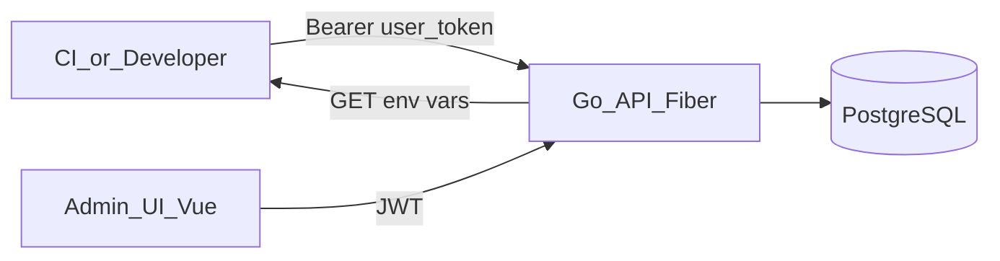
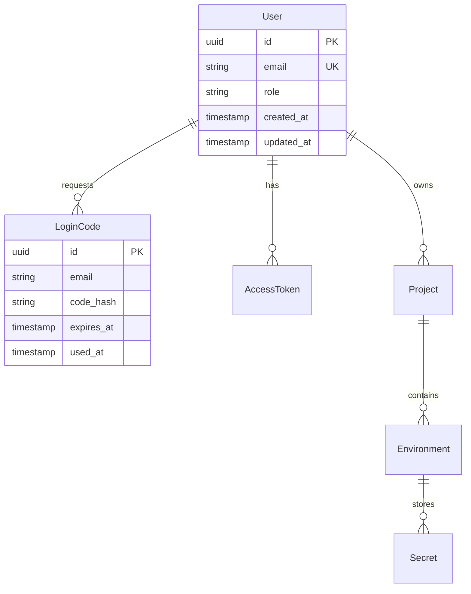

# Architecture

This document describes the architecture of **envm-vault**.

## Overview

envm-vault is an open-source environment variable vault. Users download environment variables for projects across customizable environments using a personal access token.



## Current Implementation (Phase 1)

The API lives in `api/` and provides authentication via email OTP.

### Stack

| Component | Choice |
|-----------|--------|
| Language | Go 1.25+ |
| HTTP | Fiber v2 |
| Database | PostgreSQL 16 |
| DB driver | GORM (postgres driver) |
| Schema | GORM AutoMigrate |
| Data access | repository layer |
| Auth | Email OTP (8 digits, 10 min, max 5 verify attempts) + JWT |
| Admin UI | Vue 3 + Vite + TypeScript |
| UI styling | Tailwind CSS v4 + daisyUI 5 |

### API Endpoints

| Method | Route | Auth | Description |
|--------|-------|------|-------------|
| `GET` | `/v1/health` | — | Health check (API + DB) |
| `GET` | `/health` | — | Health check alias (infra probes) |
| `POST` | `/v1/auth/login` | — | Request OTP via email |
| `POST` | `/v1/auth/verify` | — | Verify OTP, returns JWT |
| `POST` | `/v1/auth/register` | JWT (admin+) | Register user (email + role) |

### Auth Flow

1. **Bootstrap:** When no users exist, the first successful OTP verification creates a `super_admin`.
2. **Login:** Registered users request OTP via `/v1/auth/login`, verify via `/v1/auth/verify`.
3. **Register:** `super_admin` or `admin` creates users via `/v1/auth/register` with role `admin` or `user`.

In development (`APP_ENV=development`), OTP codes are logged to stdout instead of sent via email.

The admin UI (`frontend/`) implements the same OTP flow on `/login`. Dev server: `http://localhost:3100` (proxies `/v1` to the API). CORS origins are configured via `CORS_ORIGINS` (JSON array).

## Core Concepts (planned)

### Project

A logical grouping of environment variables (e.g. `my-app`, `payment-service`).

### Environment

A named deployment target within a project. Environments are fully customizable per project.

### Secret / EnvVar

A key-value pair scoped to a **Project + Environment** combination.

### User

An account with role `super_admin`, `admin`, or `user`. Authenticates via email OTP.

### AccessToken

A programmatic credential for downloading env vars (Phase 2). Scoped to project/environment pairs.

## Repository Structure

```
envm-vault/
├── api/                  # Go API (Fiber)
│   ├── cmd/server/
│   ├── internal/
│   │   ├── router/       # Route registration by context (health, auth, user)
│   │   ├── handler/      # Handlers per domain (auth/, user/, health/)
│   │   ├── service/      # Business logic per domain (auth/, user/)
│   │   ├── middleware/
│   │   ├── database/     # GORM connection + AutoMigrate
│   │   ├── model/        # GORM models
│   │   ├── repository/   # data access layer
├── frontend/             # Vue 3 admin UI (Vite :3100)
├── docs/
├── docker-compose.yml
└── Makefile
```

## Data Model



### User Roles

| Role | Description |
|------|-------------|
| `super_admin` | First user (bootstrap). Full access. |
| `admin` | Can register users. Full access. |
| `user` | Standard user. |

## Security Principles

1. **Never store plaintext OTP codes** — only SHA-256 hashes in `login_codes`.
2. **Never log secret values** — OTP codes are logged only in development.
3. **OTP verify lockout** — max 5 failed attempts per code (`attempt_count`); then the code is invalidated and the user must request a new OTP.
4. **Global HTTP rate limit** — per-IP limiter (`RATE_LIMIT_MAX` / `RATE_LIMIT_WINDOW`, defaults 100/1m). `/health` and `/v1/health` are exempt. In-memory store (single instance); shared store needed for multi-replica later.
5. **Token scoping** — access tokens (Phase 2) limited to project/environment pairs.
6. **No secrets in the repository** — never commit real tokens or `.env` files.
7. **JWT expiry** — configurable via `JWT_EXPIRY` (default 24h).

## Open Decisions

| Decision | Status |
|----------|--------|
| Response format (`.env` vs JSON) | TBD (Phase 2) |
| SMTP provider for production email | TBD |
| Encryption at rest for secrets | TBD (Phase 2) |
