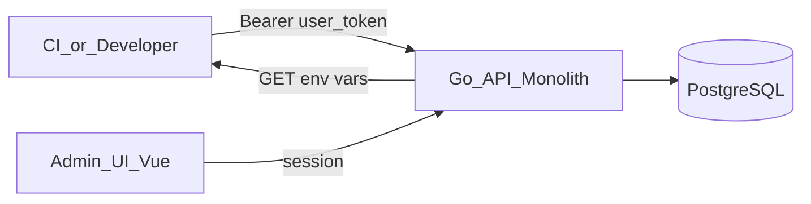
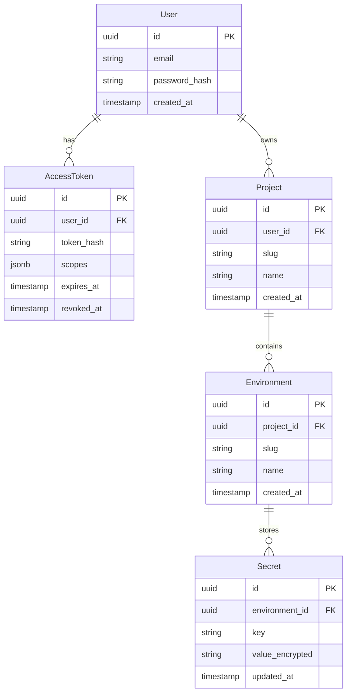

# Architecture

This document describes the planned architecture of **envm-vault**. The repository is currently in documentation phase — no application code exists yet.

## Overview

envm-vault is an open-source environment variable vault. Users authenticate with a personal access token and download environment variables for projects across customizable environments (e.g. `dev`, `tst`, `staging`, `prod`).



## Core Concepts

### Project

A logical grouping of environment variables (e.g. `my-app`, `payment-service`).

### Environment

A named deployment target within a project. Environments are fully customizable per project — there is no fixed set. Common examples: `dev`, `tst`, `staging`, `prod`.

### Secret / EnvVar

A key-value pair scoped to a **Project + Environment** combination.

### User

An account that owns or administers projects. Manages tokens and configuration through the admin UI.

### AccessToken

A unique token issued to a user for programmatic access. Tokens are scoped to specific projects and/or environments. Used via `Authorization: Bearer <token>` header.

## Planned API Flow

Primary use case — download environment variables:

```
GET /v1/projects/{project}/environments/{env}
Authorization: Bearer <access_token>
```

Response format (TBD): `.env` plain text or JSON.

### Planned Admin Endpoints (future)

- CRUD for projects, environments, secrets
- Token management (create, revoke, scope)
- User authentication (session-based for UI)

## Repository Structure (planned)

```
envm-vault/
├── backend/          # Go monolith API (Phase 1)
├── frontend/         # Vue 3 admin UI (Phase 3)
├── docs/
├── .cursor/
└── ...
```

## Backend Stack (planned)

| Component | Choice |
|-----------|--------|
| Language | Go 1.22+ |
| Database | PostgreSQL |
| DB driver | pgx |
| HTTP router | TBD (chi or echo) |
| Layout | `cmd/`, `internal/`, `pkg/` |

## Frontend Stack (planned)

| Component | Choice |
|-----------|--------|
| Framework | Vue 3 |
| Language | TypeScript |
| Build | Vite |
| State | Pinia |
| API style | Composition API + composables |

## Security Principles

1. **Never store plaintext secrets in logs** — redact values in all log output.
2. **Encrypt secrets at rest** — Phase 2; use envelope encryption with a master key.
3. **Token scoping** — access tokens must be limited to explicit project/environment pairs.
4. **No secrets in the repository** — never commit real tokens, `.env` files, or credentials.
5. **Audit trail** — log token usage (who, when, which project/env) without logging secret values.

## Data Model (draft)



## Open Decisions

| Decision | Status |
|----------|--------|
| Response format (`.env` vs JSON) | TBD |
| HTTP router (chi vs echo) | TBD |
| Encryption library | TBD (Phase 2) |
| Auth for admin UI (session vs JWT) | TBD (Phase 3) |
